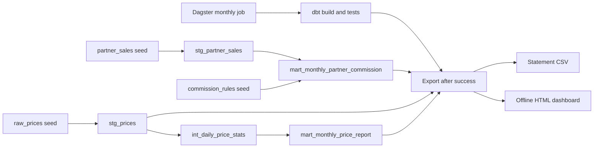
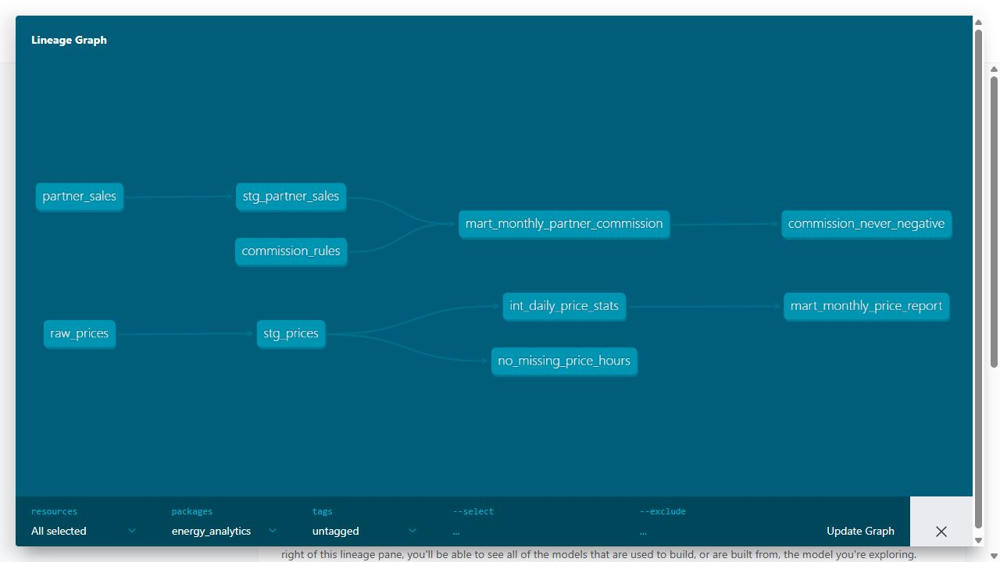
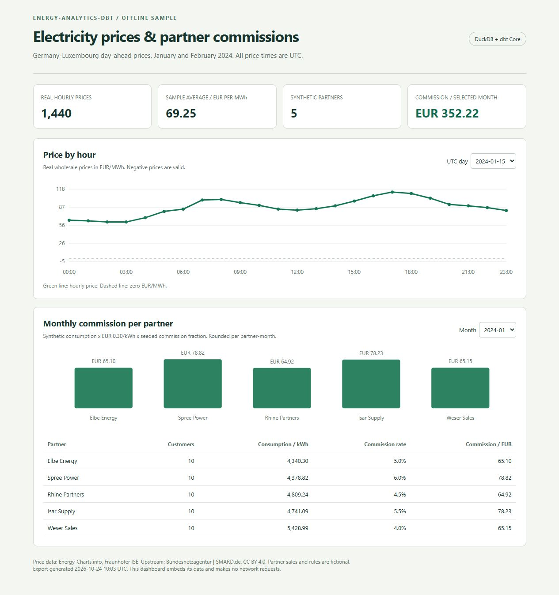

# energy-analytics-dbt

A small dbt Core project on a local DuckDB file. It combines real hourly German electricity prices with fictional partner consumption, produces two monthly reports, and exports a CSV and an offline HTML dashboard. Dagster runs as a normal Python process. No Docker is used.

The scope is five SQL models, three CSV seeds, 44 dbt data tests, one Dagster job, one monthly schedule and one dashboard. Allow about 90 to 120 minutes to set up, run, inspect and explain the project from a fresh clone, including dependency downloads.



## Data and license

- **Real prices:** 1,440 hourly DE-LU day-ahead observations, from `2024-01-01 00:00` inclusive to `2024-03-01 00:00` exclusive, in UTC. DE-LU is the Germany-Luxembourg bidding zone. Units are EUR/MWh. Negative prices are retained.
- **Source:** [Energy-Charts.info API, Fraunhofer ISE](https://api.energy-charts.info/), using [this fixed historical request](https://api.energy-charts.info/price?bzn=DE-LU&start=2024-01-01T00%3A00Z&end=2024-02-29T23%3A00Z), retrieved 24 October 2026. The response identifies the upstream source as **Bundesnetzagentur | SMARD.de** and explicitly licenses these prices under **[CC BY 4.0](https://creativecommons.org/licenses/by/4.0/)**. See the [SMARD data-use terms](https://www.smard.de/en/datennutzung).
- **Changes to source data:** converted Unix seconds to UTC timestamp strings, selected three CSV columns, and formatted prices to two decimal places. The exact request, returned license text and CSV SHA-256 are in [data/provenance.json](data/provenance.json).
- **Synthetic consumption:** five partners, ten customers per partner, and two monthly kWh records per customer: 100 rows. `scripts/generate_partner_sales.py` uses seed 42. Re-running it reproduced the committed CSV byte for byte.
- **Commission rules:** five fictional partner names, commission fractions from 4% to 6%, and a fixed demonstration retail tariff of EUR 0.30/kWh. A fraction of `0.05` means 5%. These are not real tariffs or contracts.

The code is MIT licensed. The real price CSV is separately licensed under CC BY 4.0 with the attribution above. Dependency installation needs internet access once. Builds, tests, docs generation, exports and the dashboard use only the committed inputs afterward. There are no dbt package downloads or remote DuckDB extensions.

## Models and calculations

| Model | Grain | Purpose |
| --- | --- | --- |
| `stg_prices` | UTC hour | Parse real prices and expose date, hour and bidding zone |
| `stg_partner_sales` | Customer-month | Parse synthetic monthly consumption and create a unique key |
| `int_daily_price_stats` | UTC day | Minimum, maximum, average, negative hours and cheapest three hours |
| `mart_monthly_partner_commission` | Partner-month | Customer count, kWh, revenue and commission statement |
| `mart_monthly_price_report` | UTC month | Daily/hourly counts and monthly wholesale price statistics |

Cheapest hours need not be consecutive. Ties are resolved by earlier UTC timestamp. The monthly price average weights each day's average by its observed hour count and rounds only the final result to six decimals. Commission is `total_kwh * retail_rate_eur_per_kwh * commission_pct`, rounded once per partner-month to euro cents using decimal arithmetic. It does not use the wholesale spot price as a retail tariff. All model and seed columns have descriptions in dbt docs.

## Run in order on Windows PowerShell

Use Python 3.12 and Git. Commands below use the virtual environment executables directly, so PowerShell activation policy changes are unnecessary. On this prepared checkout, `.venv` already exists. On a fresh clone, start at step 1.

1. **Clone and install, about 15 to 25 minutes.**

   ```powershell
   git clone https://github.com/hamza2829/energy-analytics-dbt.git
   cd energy-analytics-dbt
   py -3.12 -m venv .venv
   .\.venv\Scripts\python.exe -m pip install -r requirements.txt
   $env:DBT_SEND_ANONYMOUS_USAGE_STATS = 'false'
   ```

   If `py -3.12` is unavailable, install Python 3.12 first. On macOS/Linux use `python3.12 -m venv .venv` and `.venv/bin/` in place of `.venv\Scripts\`.

2. **Inspect the committed inputs, about 5 minutes.** Open `seeds/raw_prices.csv`, `seeds/partner_sales.csv`, `seeds/commission_rules.csv` and `data/provenance.json`. The rules are deliberately small. To reproduce the synthetic CSV:

   ```powershell
   .\.venv\Scripts\python.exe scripts/generate_partner_sales.py
   git diff --exit-code -- seeds/partner_sales.csv
   ```

   Do not run `fetch_prices.py` during the offline walkthrough. It is an optional online re-download of the same fixed historical period, not a live ingestion service.

3. **Build the five models and run tests, about 10 minutes including inspection.**

   ```powershell
   .\.venv\Scripts\dbt.exe build --profiles-dir .
   ```

   Expect 5 models, 3 seeds and 44 passing data tests. The final `PASS=52` includes models and seeds as well as tests. The database is `data/energy.duckdb`. Screenshot the final terminal summary if you want extra test evidence.

4. **Check that the custom tests can fail, about 10 minutes.** Close any other database writer first.

   ```powershell
   .\.venv\Scripts\python.exe -m scripts.check_test_failures
   .\.venv\Scripts\python.exe -m scripts.verify_results
   ```

   The first command intentionally causes five dbt test failures, then rebuilds from the unchanged CSV seeds and exports the restored results. Its successful final exit is expected. The second independently checks the commission calculations, all 60 daily price rows and both monthly price averages against CSV inputs using Python Decimal. It also evaluates one Dagster schedule request. Read `verification/failure_checks.json` and `verification/results.json`. Screenshot the missing-hour failure and the restored 44-test result if you want to explain the fix.

5. **Generate and inspect dbt docs, about 10 minutes.**

   ```powershell
   .\.venv\Scripts\dbt.exe docs generate --profiles-dir .
   .\.venv\Scripts\dbt.exe docs serve --profiles-dir . --port 8080
   ```

   Open [localhost:8080](http://localhost:8080). Use the lineage graph icon at the bottom right, then expand the graph if needed. **Screenshot the full graph with both price and commission paths and the two custom test nodes visible.** Save it as `docs/screenshots/dbt-lineage.jpg`. Open a model and check its column descriptions too. Stop the docs server with Ctrl+C when finished.

6. **Execute the actual Dagster job once, about 10 minutes.**

   ```powershell
   .\.venv\Scripts\python.exe orchestration.py
   ```

   Expect `RUN_SUCCESS`. The job first runs `dbt build`; only success allows the CSV and dashboard export. It exports all ten available partner-month statements into `artifacts/monthly_partner_commission.csv` and generates `dashboard/index.html`. Re-running replaces the same files. The job does not append duplicate statements.

7. **Inspect the monthly schedule, about 10 minutes.**

   ```powershell
   $env:DAGSTER_HOME = (New-Item -ItemType Directory -Force .dagster).FullName
   .\.venv\Scripts\dagster.exe dev -f orchestration.py --host 127.0.0.1 --port 3000
   ```

   Open [localhost:3000](http://localhost:3000). There is one job and one schedule: `0 6 1 * *`, first day of each month at 06:00 **Europe/Berlin**. The schedule starts disabled. Enable it in the UI if you want timed runs. `dagster dev` starts the webserver and daemon as ordinary local processes; both the process and computer must remain running for schedule ticks. Optionally screenshot the job graph, successful run and schedule details. This project verified a job execution and a schedule evaluation, not a month of unattended operation.

8. **Open and screenshot the dashboard, about 10 minutes.** In another terminal:

   ```powershell
   Start-Process .\dashboard\index.html
   ```

   Select UTC day **2024-01-15** and commission month **2024-01**. **Capture a full-page screenshot containing the hourly line chart, all five commission bars, partner table and source attribution.** Save it as `docs/screenshots/dashboard.jpg`. Change both controls and confirm the chart and amounts update. The file embeds its data, CSS and JavaScript, so it also opens directly without a server or internet connection. Reopen or refresh it after a new export.

9. **Review GitHub history and CI, about 10 minutes.** Inspect [PR #1](https://github.com/hamza2829/energy-analytics-dbt/pull/1) and [PR #2](https://github.com/hamza2829/energy-analytics-dbt/pull/2). Both use short feature branches and merge commits. Inspect the **Offline analytics** workflow and download its `analytics-results` artifact. Optionally screenshot both merged PRs and a green Actions run.

   ```powershell
   git log --graph --oneline --all
   ```

   CI installs dependencies on Ubuntu/Python 3.12, runs `dbt build`, checks intentional failures and restoration, verifies calculations/schedule, generates docs and uploads the manifest, run results, catalog, docs HTML, log, statement CSV, dashboard and verification JSON. Artifact upload runs even after a failing step so available diagnostics are retained.

## Verified results

The verification date is 24 October 2026. Machine-readable local evidence is committed under `verification/`. GitHub Actions repeats the checks on Ubuntu.

| Check | Observed result |
| --- | --- |
| dbt models | 5 built successfully |
| Seeds | 1,440 real price rows, 100 synthetic sales rows, 5 commission rules |
| dbt data tests | 44 passed: 42 generic tests and 2 custom SQL tests |
| Generic test types | `unique`, `not_null`, `accepted_values`, `relationships` |
| Custom test checks | Missing hour, whole missing day, duplicate, off-grid timestamp and negative commission all caused the expected failures |
| Failure hit and fixed | Deliberately deleted `2024-01-15 12:00 UTC` from the generated staging table; `no_missing_price_hours` failed with 1 row; rebuilding from the committed seed restored the hour and all 44 tests passed |
| Verification counter fix | After docs generation, successful tests appeared as `success` in `run_results.json`; counting only `pass` returned zero. The verifier now identifies test resource IDs and accepts both successful statuses, then asserts exactly 44 tests |
| Independent arithmetic checks | 10 commission statements, 60 daily rows and 2 monthly price averages matched CSV calculations |
| Example commission | January P01: 4,340.30 kWh x EUR 0.30 x 5% = **EUR 65.10** after rounding |
| Total sample commission | EUR 708.90 across both months and five fictional partners |
| Dagster | One actual job run succeeded; schedule evaluation returned one run request |
| Dashboard | Both selectors changed the displayed data; full-page screenshot captured |
| dbt docs | Catalog generated and actual lineage screenshot captured |

The bad-data checks are intentional regression cases, not claims that the public source had these defects. No unexpected missing hour was found in the downloaded sample.

| Price report / UTC month | Hours | Min EUR/MWh | Max EUR/MWh | Average EUR/MWh | Negative hours |
| --- | ---: | ---: | ---: | ---: | ---: |
| 2024-01 | 744 | -4.84 | 150.09 | 76.634261 | 16 |
| 2024-02 | 696 | -0.13 | 136.22 | 61.357371 | 4 |

## Screenshots

These are actual captures of generated dbt docs and the running dashboard, not mockups.





## Running on BigQuery

**not yet verified on BigQuery**

DuckDB remains the default `dev` target at `data/energy.duckdb` and the only dbt target used in CI. The optional `bigquery` target uses environment variables for the Google Cloud project, dataset, location, authentication method and service account key path. Keys are never part of the repository. The separate optional adapter environment leaves the working DuckDB environment alone.

Follow [the ordered BigQuery sandbox setup](docs/bigquery.md) to create your no-billing project, enable the API, create the dataset, authenticate yourself, install the adapter, load seeds and run the build. It includes the exact PowerShell commands and screenshot checklist.

| BigQuery run result | Actual status |
| --- | --- |
| Cloud model builds | Not yet run by the user |
| Cloud data tests | Not yet run by the user; no passing count claimed |
| Differences from DuckDB | NUMERIC/INT64/ARRAY types and adapter-specific date/array syntax; cloud result comparison is pending |
| Local setup result | The installed BigQuery adapter parsed the project successfully. A normal compile attempt stopped with missing application default credentials; no BigQuery query was executed |
| Failure encountered in a cloud build | No cloud build has been performed, so model/test results and cloud failures remain unverified |
| Required screenshots | Dataset with eight tables and terminal showing the BigQuery build/test summary; pending the user's run |

The five model transformations retain the same calculations. The existing test files and test definitions are preserved. A small BigQuery-only wrapper translates the frozen hourly-calendar test's generator syntax. The guide's BigQuery commands use `--target-path target/bigquery` to preserve the DuckDB run artifacts.

## Limits and what I would change

- BigQuery is optional and not yet verified on BigQuery. No billing account or cloud credentials were created. The user must run it before adding a cloud success claim. Sandbox expiration, quotas and feature restrictions apply.
- This is a fixed two-month sample. The monthly schedule rebuilds the sample and exports all available months. It does not download new months, handle backfills or create statements for the current month.
- All reporting uses UTC. A German billing system would need Europe/Berlin delivery periods and explicit handling of 23-hour and 25-hour days. The completeness test is intentionally anchored to the declared sample range, so an entirely absent day cannot disappear silently.
- The sample has hourly market data from 2024. Supporting newer market intervals would require interval-aware ingestion and tests rather than assuming one row per hour.
- Commission rules are fixed and fictional. A real statement needs dated contracts, tariff changes, VAT rules, adjustments, customer ownership history and reconciliation. Wholesale price reports do not establish actual customer revenue.
- DuckDB is a local file with one writer. The dashboard reads an exported snapshot. Avoid running the manual job and another writer at the same time. I would add a run-concurrency limit and a hosted database if concurrent use became necessary.
- Dagster only schedules while its daemon and the computer are running. No production hosting, alerting, recovery guarantees or long-running schedule reliability were verified.
- Top-level package versions are pinned. Transitive dependencies are resolved during installation; a cross-platform lock file would improve reproducibility further.
- This intentionally omits live ingestion, incremental models, billing integration and production access control to keep the project small.
